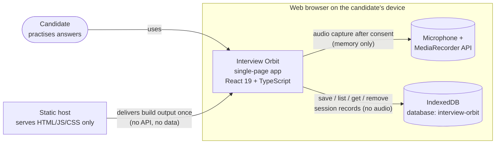
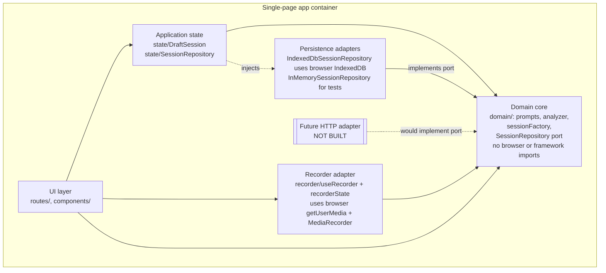
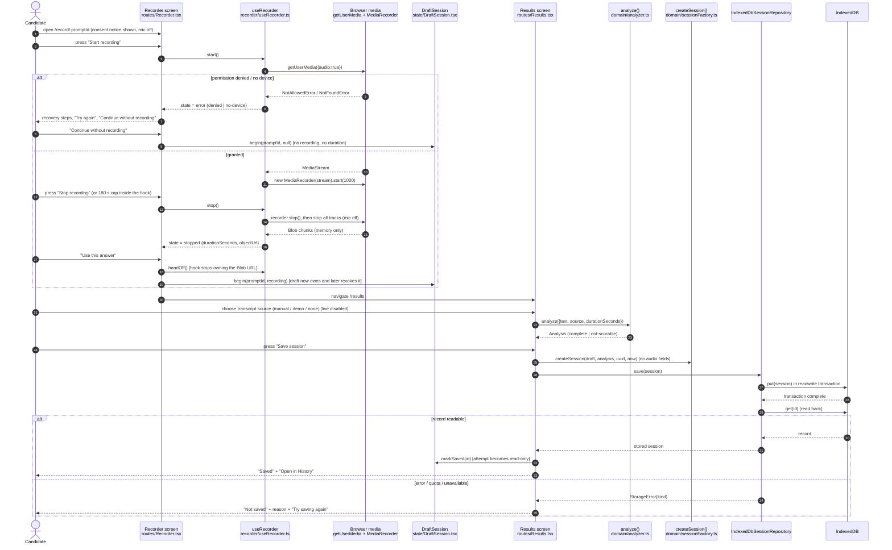
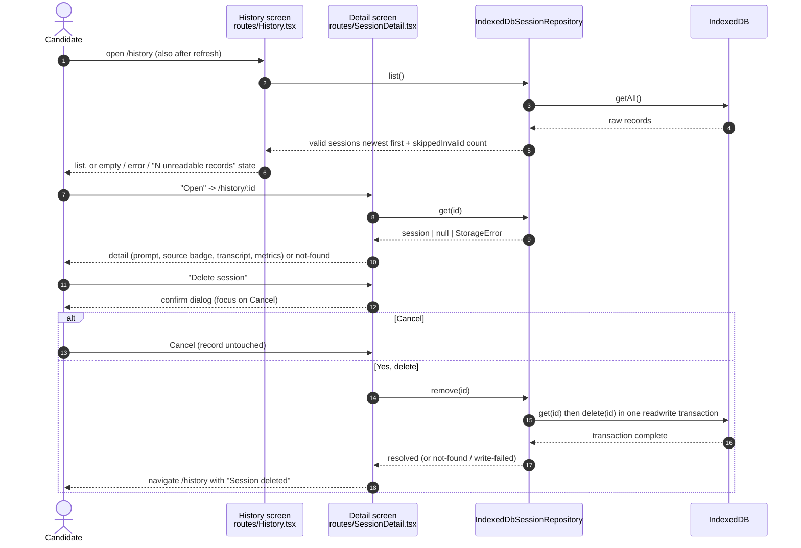

# Interview Orbit: Architecture (as built)

Version: IO-07 V001, 2026-10-16. Describes the code in `github.com/bthoreau88/interview-orbit`. The IO-10 recorder fix
(commit `bcc98f6`, 2026-10-25) added a cancellation guard to `useRecorder.ts`; line references are current. Every box and arrow below maps to a file listed in the tables. Where the
V002 planning PDF proposed something different, the difference is stated in [Plan vs. built](#plan-vs-built).

Related: [ADR-001](adr/ADR-001-client-modules-and-persistence-port.md) ·
[ADR-002](adr/ADR-002-transcript-provenance.md) · [ADR-003](adr/ADR-003-accessible-liquid-material.md) ·
[Data contract](DATA_CONTRACT.md) · [Quality traceability](QUALITY_TRACEABILITY.md) · rendered diagrams in [`diagrams/`](diagrams/).

## 1. System context

One person practises interview answers in a browser. There is no server, no account, and no third-party
service at runtime. The only external system is the browser itself (microphone, MediaRecorder, IndexedDB).

## 2. Containers

| Container | Technology | Responsibility | Built? |
|---|---|---|---|
| Single-page app | React 19, TypeScript 5.9, Vite 8, react-router 7 | All UI, domain logic, recording | Yes |
| Browser storage | IndexedDB (`interview-orbit` v1, store `sessions`) | Durable session records on one device | Yes |
| Static host | Any static file host (Netlify-compatible `public/_redirects`) | Serves the build | Not deployed |
| Session API + database | Proposed: HTTP API + SQLite | Server persistence | **No** (see ADR-001) |

Dependency rule (ADR-001): arrows point **into** `domain/`. The domain has no imports from React, the router,
storage, or browser media APIs. This is enforced by `src/architecture.test.ts`, which fails the build if:

- `domain/` imports React, the router, or any other layer;
- `persistence/` imports anything other than `domain/`;
- a route or component imports a storage adapter directly;
- any file outside `recorder/` calls `getUserMedia` or `new MediaRecorder`;
- any source file performs network I/O (`fetch`, XHR, WebSocket, `sendBeacon`).

## 3. Components (single-page app)

| Component | File | Notes |
|---|---|---|
| Routes | `src/main.tsx:33-39` | `/`, `/practice`, `/record/:promptId`, `/results`, `/history`, `/history/:sessionId`, `*` |
| Prompt catalog | `src/domain/prompts.ts:25` | 8 curated prompts, 5 categories; static (no API) |
| Analyzer | `src/domain/analyzer.ts:98` | Pure function, version `io-analyzer/1` (`:11`) |
| Session factory + validation | `src/domain/sessionFactory.ts:11,38,55` | Builds records without audio; validates records read back |
| Persistence port | `src/domain/sessionRepository.ts:8` | `save`, `list`, `get`, `remove`; typed `StorageError` (`:22`) |
| IndexedDB adapter | `src/persistence/indexedDbSessionRepository.ts:13` | Commit-then-read-back save (`:87-97`) |
| In-memory adapter | `src/persistence/inMemorySessionRepository.ts:6` | Tests; simulated failures |
| Recorder state machine | `src/recorder/recorderState.ts:23` | Pure reducer: unsupported / idle / requesting / recording / stopped / error |
| Recorder adapter | `src/recorder/useRecorder.ts:20` | Only place that opens the microphone (`:53`) |
| Draft session | `src/state/DraftSession.tsx:26` | In-memory attempt; owns the audio Blob URL lifecycle |
| Repository provider | `src/state/SessionRepository.tsx:7` | Injects the adapter (IndexedDB by default) |

## 4. Runtime: record, review, save

## 5. Runtime: History, open, delete

## 6. Deployment view

Build output (`npm run build` → `dist/`) is static files. `public/_redirects` lets a Netlify-style host
serve `index.html` for deep links such as `/history/<id>`. Nothing has been deployed from this codebase; the
existing `interview-orbit-prototype.netlify.app` site is a different, earlier upload and is untouched.

## 7. Quality scenarios (PDF p. 7) mapped to code and tests

| Scenario | Mechanism | Evidence |
|---|---|---|
| Reliability: no fake "Saved" | Save resolves after commit + read-back; errors surface | `indexedDbSessionRepository.ts:87-97`; e2e `AT-13` |
| Security: no client secrets; bounded input | No env vars or network code; transcript capped at 20,000 chars | `architecture.test.ts` (no network); `sessionFactory.ts:5` |
| Privacy: consent, retention, delete | Mic opens only in `start()`; audio memory-only; delete removes record | `useRecorder.ts:53`; e2e `AT-02/03/18`, `AT-09..12` |
| Maintainability: provider isolation | Persistence port + adapters; transcript source enum | ADR-001, ADR-002; contract tests |
| Portability: Chrome/Edge, mobile width | Feature detection + unsupported path; 360px tests | `useRecorder.ts:7`; e2e mobile-360 project |

## Plan vs. built

| V002 PDF proposal | Built | Why | Record |
|---|---|---|---|
| React/TypeScript client | React 19 + TypeScript | As proposed | — |
| ASP.NET Core Web API | None | No existing source to preserve; static deploy target; second toolchain in an 11-day sprint | ADR-001 |
| SQLite / EF Core | IndexedDB in the browser | Deployable as static files; survives refresh; honestly labelled as local | ADR-001 |
| `GET /api/prompts` etc. | Same operations as an in-process port | HTTP contract kept as a specification for a future adapter | [Data contract §4](DATA_CONTRACT.md#4-proposed-http-api-not-implemented) |
| Speech-to-text adapter | Provenance enum; live source disabled | No verified provider; browser STT can upload audio | ADR-002 |
| Liquid glass UI | Token-driven material with opacity floor | Accessibility first | ADR-003 |
